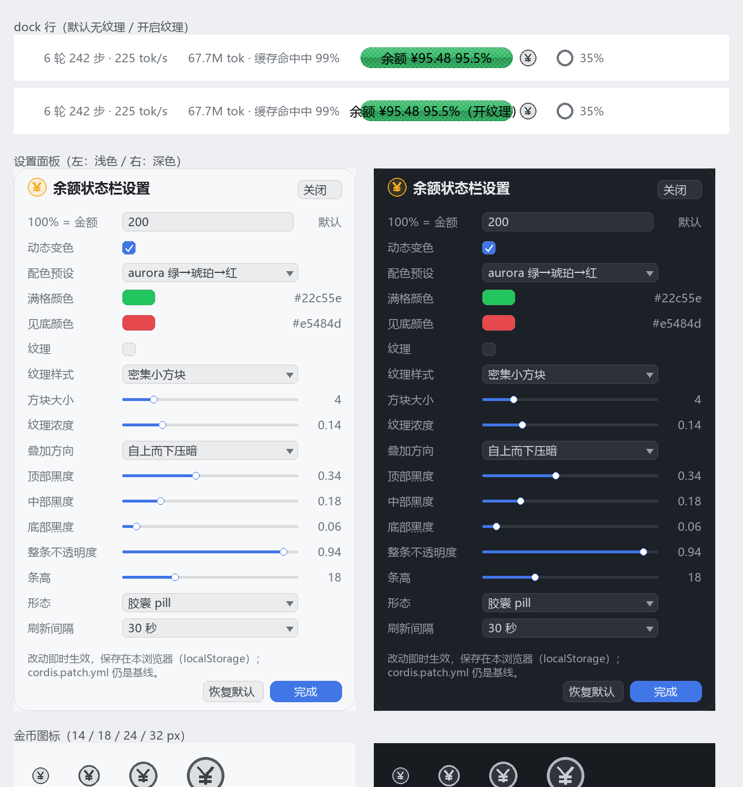

# dsh-balance-strip

[](https://www.npmjs.com/package/@melatonin-cz/dsh-balance-strip)
[](LICENSE)
[](https://github.com/deepseek-ai)


DSH 输入框下方状态行**最右侧**的一小截余额状态栏：金额 + 百分比 + 100%绿→0%红 连续色带；
条形后面一个金币入口打开图形化设置面板。文案跟随客户端语言（中文 / English）。

<br clear="right" />



## 安装

```bash
dsh plugin --profile desktop add @melatonin-cz/dsh-balance-strip
```

或在本机开发时直接链目录：

```bash
dsh plugin --profile desktop add /path/to/dsh-balance-strip
```

## 安装

本地目录（开发时最顺）：

```bash
dsh plugin --profile desktop add ./dsh-balance-strip
```

装完在 DSH 里让它重新组合（桌面端重启应用，或等 HMR 生效）。卸载：

```bash
dsh plugin --profile desktop remove dsh-balance-strip
```

也可以打包成 tgz 再装：`npm pack` → `dsh plugin --profile desktop add ./dsh-balance-strip-0.1.0.tgz`。

## 配置

配置写在 **profile 的 `cordis.patch.yml`** 里（`~/.dsh/profiles/desktop/cordis.patch.yml`），本包自带的 `cordis.patch.yml` 只是默认值。最常改的三个：

```yaml
- id: dsh-balance-strip
  config:
    anchor: 200        # 100% 对应 ¥200：余额 ¥200 满格绿，¥100 是 50%，¥400 还是满格
    dynamic: true      # false = 静态中性条
    colorHigh: '#00c06a'   # 满格颜色（palette: custom 时生效）
    colorLow: '#ff3b30'    # 见底颜色
```

完整键、取值范围与语义见 [docs/PRD.md](docs/PRD.md#5-配置表cordispatchyml--config)：

| 想做什么 | 改哪个 |
|---|---|
| 100% 对应金额 | `anchor`（默认 100，单位跟随余额接口返回的币种） |
| 关掉变色 | `dynamic: false` |
| 自定义两端颜色 | `palette: custom` + `colorHigh` / `colorLow` |
| 换一套预设 | `palette: aurora \| signal \| mono` |
| 更「高级」的两端压暗 | `overlay.direction: vignette`、`overlay.bottom: 0.28`、`overlay.top: 0.40` |
| 更暗/更亮的叠加 | `overlay.top` / `overlay.mid` / `overlay.bottom`（0–1） |
| 整条更透 | `opacity: 0.7` |
| 只要一根细线 | `variant: rail` |
| 刷新频率 | `pollSeconds: 30`（10–600） |

配色预设：`aurora`（绿→琥珀→红，默认）、`signal`（四站、分段感更强）、`mono`（不用红绿的亮度带）。

## 界面

- 位置：输入框下方状态行**最右**（官方上下文占用环之后；dock 是 flex，插件用 `order: 99`）。
- 条形后面一个 18px 齿轮：点开图形化设置面板（anchor / 动态开关 / 配色 / 两端颜色 / 纹理 / 叠加三段黑度 / 透明度 / 条高 / 形态 / 刷新间隔），改动即时生效，存在本浏览器 localStorage，且宿主 config 仍是基线。
- 底色默认**无纹理**（干净的纯色胶囊）；在面板里可开启「密集小方块 / 点阵 / 网格」，方块 2–16px、浓度 0–0.6 可调。
- 刷新不闪：只有首次加载显示占位符，之后静默刷新；失败保留上一次数值。
- 100% 只在你手填 anchor 时才「封顶」；留空时按本币 100 计、数字如实显示（¥200 → 200%），颜色仍满格。

## 数据从哪来

两条通道，都在宿主侧完成，浏览器只读同源 JSON：

1. **API Key**：用 DSH 凭据里的 `DEEPSEEK_API_KEY`（或 `config.apiKey`）调官方 `GET /user/balance`。
2. **账号登录态**（没有 API Key 也能用）：读 DSH 账号 grant（`deepseek-account-platform/default`），带 `x-dsh-auth-token` 调 `GET https://platform.deepseek.com/api/v0/users/get_user_summary`，取充值钱包 + 赠送钱包（顺带读累计消费）。

先试 Key，失败自动回落账号通道；两条都没有时条体显示「未配置 · 点击重试」。**密钥与 grant token 永不下发前端**，响应里也不含 `apiKey` 字段。

> 改了宿主半区代码（`lib/index.js`）需要**重启 DSH 桌面端**；只改客户端样式/组件时刷新页面即可。当前包以 pnpm link 方式装在 profile 里，重启后即用最新构建。

## 开发

```bash
node scripts/build.mjs         # 生成 lib/index.js + lib/client.js（ModuleLoader 形态）
node --test tests/core.test.mjs tests/host.test.mjs tests/client-bundle.test.mjs
node tools/emit-ramp.mjs aurora ../_probe/ramp.json
python tools/preview.py ../_probe/ramp.json docs/preview-aurora.png top-dark
```

- 纯函数层在 `src/shared/core.cjs`（同时被 Node 测试与浏览器 bundle 使用），UI 只拼 CSS 变量。
- 客户端 bundle 由 `scripts/build.mjs` 拼接，**不需要打包器、不打包 react**。
- 设计依据（为什么是 OKLCH、数值怎么来的）：[docs/RESEARCH.md](docs/RESEARCH.md)；需求与验收：[docs/PRD.md](docs/PRD.md)；架构与测试矩阵：[docs/TDD.md](docs/TDD.md)。

## 已知限制

- 只在 `conversation.composer.dock`（输入框下方状态行）出现；不做独立卡片/看板。
- 需要能取到 DeepSeek API Key；账号登录态取不到时用 `config.apiKey` 显式填。
- 首版没有图形化设置页，全部走 `cordis.patch.yml`。
- 「今日花费」还没接会话统计，`mode: spent` 会退化为只显示金额。
