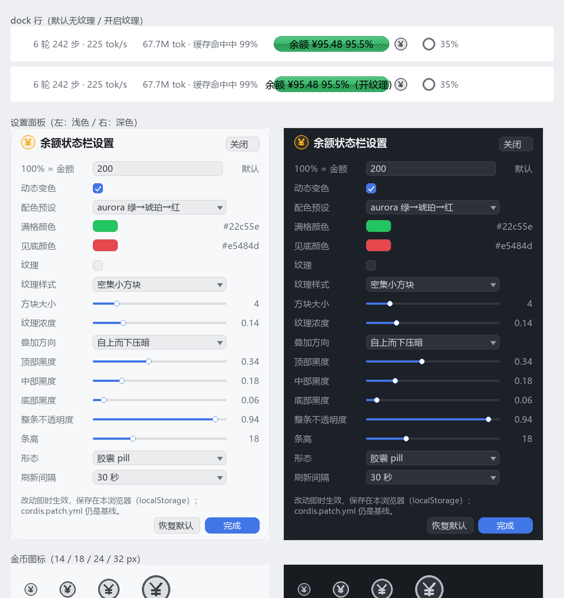

# 变更记录

## v0.3.2：纹理默认关闭

- `DEFAULTS.texture.enabled` 改为 `false`：默认渲染 `background-image: none` / `background-size: auto`，条体是干净的纯色胶囊。
- 图案、方块大小、浓度三个参数保留默认值（squares / 4px / 0.14），面板里勾上「纹理」立刻就是密集小方块。
- 本地覆盖键升到 `dsh-balance-strip:settings:v2`：v0.3.1 之前存的纹理参数结构已变（image/size 拆分），旧覆盖作废，避免「默认关闭」被历史 localStorage 顶掉。
- profile 的 `cordis.patch.yml` 同步成 `texture.enabled: false`。

## v0.3.1：纹理样式选了没反应（真 bug）

**根因**：`background-image` **不接受** `position / size` 语法（那是 `background` 简写才有的）。
v0.3 把整个值（例如 `conic-gradient(...) 0 0 / 8px 8px`）塞进了 `background-image`，
浏览器判定整条声明非法并**丢弃**——所以不只是切换样式没反应，默认的方块纹理其实也没渲染过。

**修法**
- 拆成两个变量：`--dbb-texture-image`（纯 gradient）+ `--dbb-texture-size`（`8px 8px` / `4px 4px` / `6px 6px, 6px 6px` / `auto`）。
- CSS 用 `background-image: var(--dbb-texture-image)` + `background-size: var(--dbb-texture-size)` 两个属性。
- 棋盘格从 `repeating-conic-gradient`（会转成菱形）改成轴对齐 4 象限 `conic-gradient`，更贴近「密集小方块」。

**回归守卫**：TC25 现在断言 `textureParts(...).image` **不允许**出现 `Npx Npx`，
并断言 squares / dots / grid 三种图案产出的 CSS 必须两两不同（就是这次的 bug 形态）。

**自检方式**：刷新页面后，面板里选「无」→ 纹理消失；选「点阵」→ 变成小圆点阵列；把「方块大小」从 4 调到 8 → 方块明显变大。
若仍无变化，在 devtools 里看条形元素的 `--dbb-texture-image` 是否有值。

## v0.3：设置面板被裁切 + 金币图标

**现象**：面板只在状态行下面露出一条标题就被切掉。

**诊断**：`position: fixed` 的定位基准是最近的**带 transform / filter 的祖先**，composer 那一层正是这样，
所以面板不是相对视口定位，而是被锚在 composer 的坐标系里、再被它的裁剪边界切掉。

**修法**
- 面板改为 **portal 到 `document.body`**（懒加载 `require('react-dom')`；拿不到 `createPortal` 才退回
  `position: absolute; bottom: 100%` 的内联定位）。
- 位置：`left` 夹在视口内；上方空间 ≥360px 向上弹（`translateY(-100%)`），否则向下弹并被视口高度夹住。
- 面板 `max-height: 72vh` 内部滚动；容器带 `data-dbb-panel="above|below|inline"` 便于排查放置方式。

**图标**：⚙ 换成**金币 ¥** 标记（与 `assets/coin.svg` 同几何，客户端内联 SVG，颜色跟随 `currentColor`，
hover 改为主色高亮、不再旋转）；面板标题左侧也用它作品牌标记。另产出产品 logo
[`assets/logo.svg`](../assets/logo.svg)：胶囊条 + 绿→红渐变描边 + 金币。

**可视化**：新增 `tools/ui-preview.py`，用实现里同一套色值/纹理/叠加渲染「dock 行 + 浅/深色面板 + 图标 4 档」：

```bash
python tools/ui-preview.py docs/ui-preview.png
```



## v0.2：按 5 条反馈

### C1 位置：排到上下文占比右边

- dock（`conversation.composer.dock`）是 flex 容器（`.GRgSLq_dock{display:flex;justify-content:center;gap:12px}`），
  而官方 `ContextMeter`（◔ 35%）是在**槽位渲染之后**才输出的兄弟节点。
- 注册项 `order` 提到 **99**（`DOCK_ORDER`），包裹器同时带 `order: 99` → 排在它右边。
  不再用 `margin-left:auto`（会把整簇推偏）。

### C2 anchor（100% 对应金额）

- `anchor` 只在用户手填时生效；没填 → 内部按 100 计算，但 `anchorSet=false`。
- **数字层不钳制**：¥200 / anchor 100 → 显示 `200%`；`colorFraction()` 单独把颜色钳到 0..1，超过 100% 仍是满格绿。
- 手填后按手填值算：`anchor: 400` 时 ¥200 → `50%`。

### C3 图形化设置面板

- 项：anchor、动态开关、配色预设、满格/见底颜色、纹理开关 + 样式 + 方块大小 + 浓度、
  叠加方向 + 顶部/中部/底部黑度、整条不透明度、条高、形态（pill/rail）、刷新间隔。
- 持久化：`localStorage['dsh-balance-strip:settings:v1']`，与宿主 config 深合并（宿主 config 仍是基线）；
  「恢复默认」清空本地覆盖。

### C4 底色纹理（密集小方块）

- `texture.pattern`：`squares`（默认，轴对齐棋盘格 `conic-gradient(...) 0 0 / 8px 8px`）、`dots`、`grid`、`none`。
- `texture.size` 2–16（默认 4px）、`texture.alpha` 0–0.6（默认 0.14）；走 `--dbb-texture`，与叠加层正交。

### C5 刷新不闪

- 首次加载 `status='loading'` + `…`；有数据后刷新只置 `refreshing`（文字透明度 0.72），沿用上一次数值；
  失败保留旧值并标 `stale`。纯函数 `viewOf(state, config)` 承载，测试直连。

## 验收对照

| 变更 | 测试 |
|---|---|
| 位置 order=99 | TC27 |
| anchor 非钳制 / 200% | TC09、TC14、TC26 |
| 设置面板结构与样式 | TC21/TC22、TC27（CSS 含 `.dbb-panel`） |
| 纹理四图案 + 越界钳制 | TC25 |
| 刷新不闪 | TC26 |
| 金币图标 | TC28（`CoinIcon` 渲染 `svg`） |
